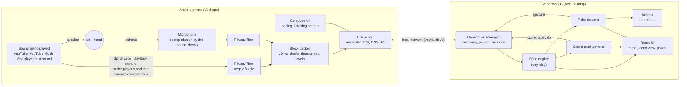
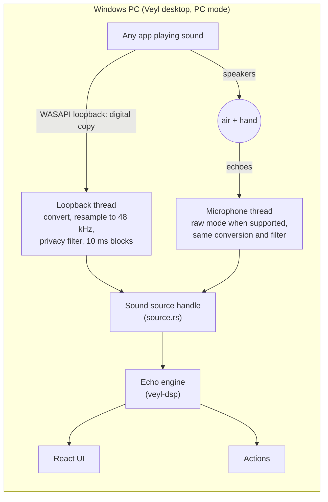
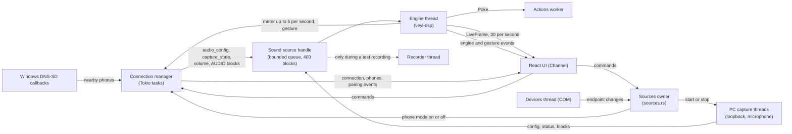

# Architecture

Veyl has two apps and one echo engine. In **phone mode** the Android app plays and listens, then
streams filtered sound to the Windows app over Veyl Link. In **PC mode** the Windows app captures
the PC's own speakers and microphone and never touches the network. Both modes feed the same Rust
engine, meter, poke detector and interface.

This page describes the parts as they exist in the code. [How it works](how-it-works.md) explains
the idea in plain words, [the echo engine](echo-engine.md) covers the signal processing,
[protocol](protocol.md) covers Veyl Link byte by byte, and
[decision 0001](decisions/0001-architecture.md) records the boundaries this design keeps.

## Components

| Component               | Language and framework  | Job                                                                                                                              |
| ----------------------- | ----------------------- | -------------------------------------------------------------------------------------------------------------------------------- |
| `android/app`           | Kotlin, Jetpack Compose | Phone mode: playback capture, Veyl player, test sound, microphone, sound check, listening service and screen, Veyl Link server   |
| `android/core`          | Pure Kotlin (JVM)       | Veyl Link frames, messages, crypto, pairing and session machines; privacy filter; block packing; BrightLoop; FFT; sound check    |
| `desktop/src-tauri`     | Rust, Tauri 2           | Discovery, pairing, connections, PC capture, engine host, actions, test recordings, settings, tray and hotkey                    |
| `desktop/src`           | React, TypeScript       | The window: Live, Phones, Settings and Help, plus a browser preview with sample data                                             |
| `crates/veyl-dsp`       | Rust, no platform code  | The echo engine: alignment, echo map, background, motion, poke detector, meter; also the privacy filter, test sound, sound check |
| `crates/veyl-link`      | Rust                    | Veyl Link v1 for the PC side and the lab: framing, sealed channel, pairing, sessions, audio blocks, test vectors                 |
| `crates/veyl-sim`       | Rust                    | Acoustic simulator and the scenario catalogue used as CI gates                                                                   |
| `crates/veyl-lab`       | Rust command-line tool  | Simulate, analyze test recordings, sweep parameters, act as a fake phone, run the end-to-end test                                |
| `protocol/test-vectors` | JSON                    | Shared bytes that keep the Rust and Kotlin protocol code identical                                                               |
| `site/`                 | React, Vite             | The website, which also renders the user docs                                                                                    |

The engine is pure Rust with no Windows or Android code, so the desktop app, the lab and Linux CI
run the same processing code. See [development](development.md) for commands and the
repository layout.

## Phone mode

- **Reference.** On Android 10 and later, "Phone sound" uses Android's playback capture after the
  user approves the "record or cast" prompt. The Veyl player tees the decoded samples of the
  user's own music files, and the test sound uses the BrightLoop samples it plays. Neither of
  those needs the prompt, and both work on Android 8 and 9.
- **Microphone.** The first start on a phone runs a sound check that records each usable
  microphone setup and keeps the one whose high band best matches the test sound. Echo
  cancellation, noise suppression and automatic gain are switched off where Android allows it.
- **Filter and blocks.** Both streams pass the same eighth-order high-pass filter (8 kHz by
  default, 7 or 6 kHz only by a deliberate choice in the phone's Settings) before they are packed.
  Each 10 ms block carries frame numbers, a capture time and the block's level and peak measured
  before the filter.
- **Link.** The phone is the server and the PC the client, so Windows never accepts an incoming
  connection. The phone's writer queue holds one second of audio per stream; when it is full, the
  oldest block is dropped and the next one is marked as following a gap. Control messages are never
  dropped.

## PC mode

- **Reference.** Shared-mode WASAPI loopback on the chosen speakers copies the full mix the PC
  plays, so every app works, Spotify included. Protected video may arrive as silence.
- **Microphone.** Shared-mode capture on the chosen microphone, in raw mode when the device
  reports support, so Windows' noise suppression and echo cancellation stay out of the way. Both
  streams use `AudioCategory_Other`, never the communications category. If raw or event-driven
  capture is refused, Veyl falls back to ordinary capture and to polling every 5 ms
  ([decision 0008](decisions/0008-pc-audio-fallbacks.md)).
- **Conversion.** 16-, 24- and 32-bit integer and float samples become floats, at most two
  channels are kept, and a sinc resampler converts any other rate to 48 kHz. The fixed 8 kHz
  privacy filter then runs before the block cutter, so the engine, a test recording and the PC
  sound check only ever see filtered sound. Capture times come from the QPC positions WASAPI
  reports; discontinuities become gaps.
- **No network.** While PC mode is active, the connection manager closes any phone connection and
  stops browsing for phones.
- **Devices.** A COM thread lists endpoints with their form factor, raw support and Bluetooth
  bus, and follows Windows' default-device notifications. A changed default restarts capture; an
  invalidated stream retries after 100 ms and other failures after 5 s
  ([decision 0009](decisions/0009-source-choice-and-pc-feedback.md)). Veyl recommends PC mode
  when the PC has speakers that are not headphones and a microphone, and is either a laptop or
  has both built in. The user always decides.

## Sound sources

Both modes enter the engine through one handle, `source::PhoneSource`, which implements the
`SoundSource` trait (`configure`, `status`, `audio`). Despite its name it is the engine's single
input: the phone connection's worker calls it with blocks from Veyl Link, and in PC mode the two
capture threads in `pc_source::workers` call it with PC blocks. The engine, meter, detector and
interface never depend on which mode is active; the interface only changes its wording ("your
phone" or "this PC").

- Every source run gets a new generation number. Configurations, statuses and blocks from an
  older generation are ignored, so a cancelled start or a late callback cannot reach a newer run.
- Audio goes to the engine through a bounded queue of 400 blocks, about two seconds. A full queue
  drops the block without waiting, counts it as an engine drop in Diagnostics and marks the next
  block of that stream as following a gap.
- The same handle copies blocks to the test recorder while a recording runs, and to the PC sound
  check's in-memory tap while that check runs. Both receive the already filtered blocks, before
  any engine drop can affect them.
- `sources.rs` owns the choice between modes. It saves the mode and device choices, switches the
  connection manager on or off, opens and closes PC capture, follows device changes and runs the
  PC sound check.

## Threads and flow

**PC threads**

| Thread                             | Owner                   | Work                                                                                                     |
| ---------------------------------- | ----------------------- | -------------------------------------------------------------------------------------------------------- |
| Main thread                        | Tauri                   | Window, tray menu, global hotkey handler                                                                 |
| Tokio runtime                      | `connection`, `sources` | Connection manager actor, one worker task per phone connection, sources actor, event forwarding          |
| Windows DNS-SD callbacks           | `discovery`             | Copy each record into a bounded channel and return; never block                                          |
| `Veyl-engine`                      | `engine_host.rs`        | Owns `veyl_dsp::Engine`; receives inputs from the bounded queue; sends live frames, events and the meter |
| `Veyl-loopback`, `Veyl-microphone` | `pc_source`             | One WASAPI capture stream each, registered for MMCSS "Pro Audio" scheduling when Windows allows it       |
| `Veyl-devices`                     | `pc_devices.rs`         | COM endpoint enumeration and default-device notifications                                                |
| `Veyl-test-sound`                  | `pc_testsound.rs`       | The PC sound check's five-second render stream, only when the user starts it                             |
| `Veyl-actions`                     | `actions.rs`            | Runs `SendInput` for each poke, off the engine thread                                                    |
| `Veyl-recorder`                    | `recorder.rs`           | Writes a test recording to disk, only while one runs                                                     |
| Log writer                         | `tracing-appender`      | Writes log lines without blocking the callers                                                            |

**Phone threads.** The Compose UI runs on the main thread with coroutines. Each recorder (the
playback copy and the microphone) has its own reader thread at urgent-audio priority; the test
sound and the Veyl player each add one such thread for the reference. The link server has an
accept thread, and each session a reader thread and a writer thread that sends control messages
before audio. Two single-thread executors serialize service and network changes, and Android's
NSD callbacks arrive on system threads.

## The engine host

`engine_host.rs` stays thin so that `crates/veyl-lab/tests/e2e.rs` can make the same calls without
Tauri. [Decision 0025](decisions/0025-live-host-and-actions.md) records its choices.

- Each `audio_config` starts a new engine with the tuned defaults
  ([decision 0023](decisions/0023-tuned-defaults-and-scenario-thresholds.md)). The privacy
  filter's cutoff sets the lowest frequency it uses. PC mode switches on the engine's PC handling
  and the wider 55 cm distance limit. Capture stopping resets the engine.
- Capture state, route and the phone's media volume become the engine's source status. A phone
  route of `unknown` counts as the speaker. In PC mode the route names the speaker type
  (`speaker`, `headphones` or `bluetooth`), which drives the `pc_headphones` and `pc_bluetooth`
  tips.
- Sensitivity and range change live. A room temperature change restarts the engine, because the
  speed of sound fixes its distance scale.
- Live frames follow microphone time, 30 per second: 60 motion values (one per centimetre),
  the engine state, the hand, and the meter about 10 times a second. The interface receives them
  through the channel it registers with `subscribe_live`.
- `veyl://engine` reports state, suspension, warnings, hand and meter changes; `veyl://gesture`
  reports each poke. The phone receives `meter` at most 5 times a second and `gesture` for each
  poke.
- A poke acts only when actions are on, no poke test or onboarding practice is running and the
  poke action is not "Nothing". `ActionsGate` hands it to the `Veyl-actions` worker.
- Diagnostics keep the median and 95th percentile of the time from a poke's turning point to its
  detection on the engine thread, where any action is handed to the worker, over the last 50
  pokes.

## Desktop modules

The plan listed a few more files; tray, hotkey, logging and shared state live in `lib.rs`, the
DPAPI calls in `pairings.rs`, and discovery and the connection manager are folders.

| File                                     | Responsibility                                                                                                                                                                   |
| ---------------------------------------- | -------------------------------------------------------------------------------------------------------------------------------------------------------------------------------- |
| `main.rs`                                | Calls `veyl_desktop_lib::run()`                                                                                                                                                  |
| `lib.rs`                                 | Tauri builder: single instance, autostart (`--hidden`), global hotkey, logging, tray, window close to tray, the actions switch shared by header, tray and hotkey, shutdown order |
| `commands.rs`                            | The `#[tauri::command]` functions the interface calls                                                                                                                            |
| `events.rs`                              | Event payloads and views (`camelCase`), shared with TypeScript through JSON fixtures                                                                                             |
| `settings.rs`                            | `settings.json`: defaults, validated changes, atomic save, unknown fields kept                                                                                                   |
| `pairings.rs`                            | `pairings.json`: paired phones, link keys protected with DPAPI for the current user; views never contain a key                                                                   |
| `discovery/`                             | Windows DNS-SD browse and resolve bridge (`windows.rs`) and the nearby-phone table (`mod.rs`), entries expire after 90 s                                                         |
| `address.rs`                             | "Add by address": host name resolution and IPv4 connection under one 3 s deadline                                                                                                |
| `connection/`                            | Connection manager actor (`mod.rs`) and one worker per connection (`worker.rs`): pairing, sessions, PING, routing, reconnects                                                    |
| `source.rs`                              | `SoundSource` trait and `PhoneSource`, the engine's bounded input for both modes                                                                                                 |
| `sources.rs`                             | Mode switching, device choices, PC capture lifecycle, device-change restarts, the PC sound check                                                                                 |
| `pc_devices.rs`, `pc_devices/native.rs`  | Endpoint list, form factor, raw support, Bluetooth, defaults and the mode recommendation                                                                                         |
| `pc_source.rs`, `pc_source/*.rs`         | WASAPI capture behind the `CaptureBackend` trait, format conversion, resampling, privacy filter and block cutting                                                                |
| `pc_testsound.rs`, `pc_testsound/*.rs`   | "Check this PC's sound": five seconds of test sound and a coherence measurement kept in memory                                                                                   |
| `engine_host.rs`, `engine_host/tests.rs` | The engine thread, live frames, poke test, latency statistics                                                                                                                    |
| `actions.rs`                             | Poke actions through `SendInput` behind the `Actions` trait, with the administrator-window check                                                                                 |
| `recorder.rs`                            | Test recordings: consent-gated disk worker, Space marks, retention                                                                                                               |

**Actions.** Click sends a left button down and up at the pointer. Play or pause, Next track and
Space bar send the matching keys. Windows silently drops input sent to a window that runs with
higher integrity, such as an app running as administrator, so `actions.rs` compares integrity
levels first (the window under the pointer for a click, the foreground window for keys) and also
treats fewer inserted events than requested as blocked. Actions start off at every start unless
"Turn actions on when Veyl starts" is set.

## Data flow and timing

Each stream delivers one block every 10 ms: 480 frames at 48 kHz, or 441 at 44.1 kHz on phones
that need it. Two stereo 16-bit streams at 48 kHz use about 3.1 Mbit/s on the network. The
engine processes a 2048-frame window every 256 frames (5.33 ms) and measures change over a
1024-sample segment ([decision 0021](decisions/0021-short-change-and-steady-tracking.md)).

The plan's latency budget, from the turn of a poke to the click:

| Stage                                       | Where   | Target                        |
| ------------------------------------------- | ------- | ----------------------------- |
| Capture a 10 ms block and Android buffering | Phone   | 15–25 ms                      |
| Privacy filter, pack, encrypt, enqueue      | Phone   | < 2 ms                        |
| Network (Wi-Fi to a wired PC)               | Network | 3–20 ms median, < 40 ms p95   |
| Wait until both streams cover the next hop  | PC      | ≤ 15 ms                       |
| Echo engine                                 | PC      | 50–70 ms effective delay      |
| Poke confirmation after the turn            | PC      | 30–60 ms                      |
| Action (`SendInput`)                        | PC      | < 2 ms                        |
| Total                                       |         | Median ≤ 200 ms, p95 ≤ 300 ms |

PC mode has no network step. These are targets. In the simulator's basic scenario the median
time from the true turn to detection is 127–131 ms for seeds 1–3
([decision 0023](decisions/0023-tuned-defaults-and-scenario-thresholds.md)); real devices have
not been measured yet. Processing cost is in [decision 0024](decisions/0024-processing-cost.md).

## Storage

**PC**, in `%LOCALAPPDATA%\io.github.jacobbalane.veyl\`, so the uninstaller's "delete app data"
option can remove it:

- `settings.json` and `pairings.json`, written atomically.
- `logs\`: one file per day, seven kept. No audio samples, keys, nonces or pairing codes.
- `recordings\YYYYMMDD-HHMMSS\`, only after the user starts "Record a test": `ref.wav`,
  `mic.wav`, `blocks.jsonl`, `labels.jsonl`, `events.jsonl` and `meta.json`, all from
  filtered audio. Folders older than `keep_recordings_days` (7 by default; 0 keeps them) are
  deleted at startup. The format is described in [the lab guide](lab.md).

**Phone:** DataStore settings (phone name, filter cutoff, screen options, chosen sound, the sound
check result for this system build, chosen music), and `pairings.json` in no-backup storage with
each link key wrapped by a non-exportable Android Keystore key. Backup and device transfer are
off. Release builds write no audio.

## Where the tests sit

- Fakes replace Windows at the edges: a `CaptureBackend` fake drives the real conversion, filter
  and block cutter; an `Actions` fake records pokes without sending input.
- `crates/veyl-lab/tests/e2e.rs` pairs a simulated phone with the real `veyl-link` client,
  streams the `poke_basic` scene and requires at least 9 pokes to reach fake actions.
- `crates/veyl-lab/tests/scenario_gates.rs` replays every simulator scenario for three seeds.
- Rust writes JSON fixtures of the event types and Vitest parses them, so the two sides of the
  interface cannot drift apart.
- Android's `:core` tests reproduce every byte of `protocol/test-vectors/v1.json`.

None of these replace the device checks in the plan; their status is in [progress](progress.md).
