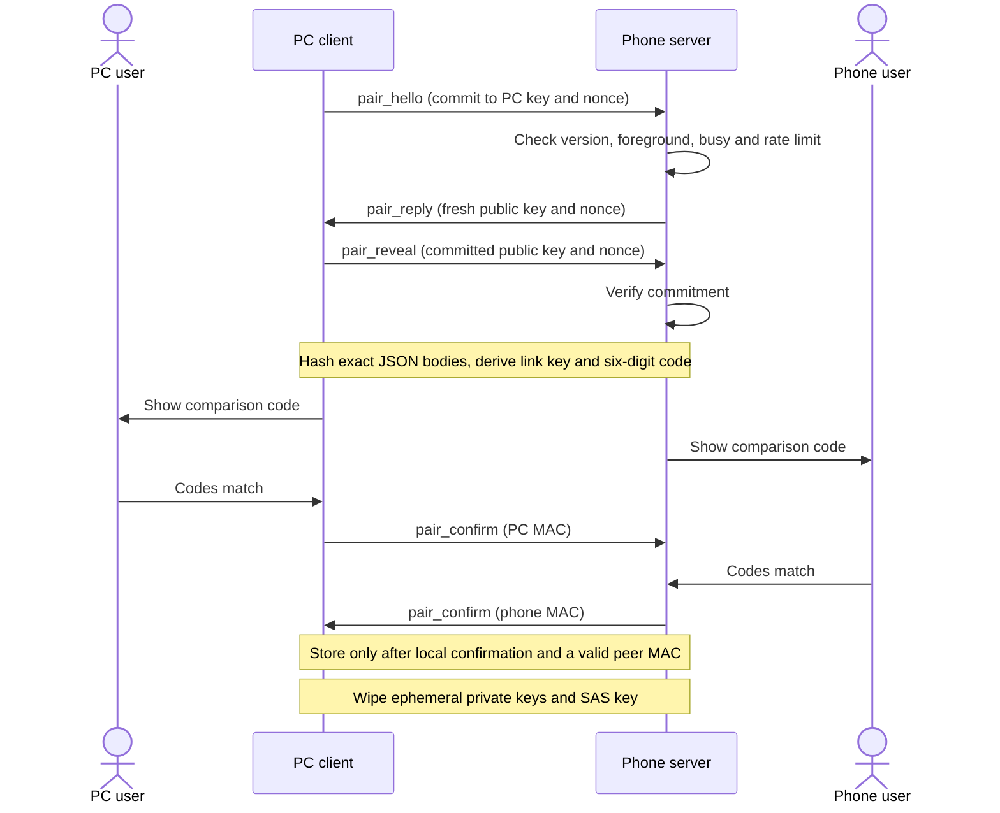

# Veyl Link protocol v1

Veyl Link is the private, encrypted connection between one phone and one PC. It is implemented
twice — in Rust (`crates/veyl-link`, used by the desktop app and by `veyl-lab`) and in Kotlin
(`android/core`). Shared test vectors (§4.15) keep the two byte-for-byte compatible.

M1 implements the protocol core and its tests. The installed 0.0.1 preview does not connect:
Android capture arrives in M2; discovery, sockets, protected pairing storage and app integration
arrive in M3. The sections below also specify those integration requirements.

## Pairing and session flow



Confirmations may arrive in either order. A valid peer MAC alone never permits storing a pairing.
Cancel, timeout, commitment mismatch and invalid MAC end the attempt and discard pending secrets.
Both roles expose `cancel` before the code is available as well as during confirmation. A UI
confirmation submitted before the code exists is ignored; it cannot preapprove an unseen code.

```mermaid
sequenceDiagram
    participant PC as PC client
    participant Phone as Phone server
    PC->>Phone: hello (PC identity, fresh public key and nonce)
    Phone->>Phone: Look up pairing; reject an unknown or busy PC
    Phone->>PC: hello_reply (phone identity, fresh public key and nonce)
    PC->>PC: Verify the expected phone identity
    Note over PC,Phone: Derive fresh keys from DH, link key and exact transcript
    Phone->>PC: SEALED counter 0: ready (device, capture)
    PC->>Phone: SEALED counter 0: ready (pc, want)
    Note over PC,Phone: Session is authenticated; each direction continues at counter 1
    Phone->>PC: SEALED: audio_config, then filtered AUDIO
    PC->>Phone: SEALED: PING
    Phone->>PC: SEALED: PONG
```

## Implementation and verification

Rust's `Pairing` and `Session` machines support both roles. Kotlin's `PhonePairing` and
`PhoneSession` implement the phone role. Their inputs are complete frames, user confirmations and
monotonic milliseconds. They return outbound frames and expose completed pairings or authenticated
channels. The caller supplies one shared rate limiter for all phone connections. The caller must
also enforce one active pairing/session, close on errors, and service timeout ticks while idle.
For an authenticated malformed AUDIO payload, first send the final `bad_message` frame returned by
`take_close_frame` / `takeCloseFrame`, if present, then close TCP. The channel has already discarded
its keys; further sealing or opening is prohibited. Unauthenticated failures close immediately.

Rust's `transport::pair` and `session` drive the PC machines. Its `Connection` retains partial
reads and writes across cancellation. Separate reader/writer halves keep simultaneous confirmations
moving even with small buffers. Production TCP uses IPv4, a three-second connect timeout and
`TCP_NODELAY`. State machines do not log messages or secret values. A received unknown sealed type
still consumes its authenticated counter; the integration ignores it and may log its type once.

Private-key owners and derived key buffers are wiped on completion, abort or close. Rust uses
zeroizing owners; Kotlin implements `AutoCloseable` and the caller uses `use` or `finally`.
JVM and cryptographic provider internals may retain copies outside those owned buffers. Link-key
storage must use the protected platform stores specified below; the protocol core does not write
keys or audio to disk. Deterministic fixture constructors exist for tests only; live machines use
OS randomness by default. Bouncy Castle supplies only low-level X25519 on Android; AES-GCM, HMAC,
SHA-256 and randomness use the platform's Java crypto APIs, including on API 26.

Run `cargo test -p veyl-link`, regenerate with
`cargo run -q -p veyl-link --example gen_vectors`, then run `.\gradlew :core:test` from `android/`.
The generator's stdout must equal `protocol/test-vectors/v1.json` exactly, without a BOM. CI checks
that comparison and both language test suites. Fixtures include public, fixed private keys; they
are never suitable for real connections. X25519 also checks the independent
[RFC 7748 section 6.1 known answer](https://www.rfc-editor.org/rfc/rfc7748#section-6.1).

The remaining numbered sections reproduce the protocol specification from the implementation plan.

## 4.1 Roles

- **The phone is the server** (it listens on TCP). **The PC is the client** (it connects out).
- Why: Windows Defender Firewall prompts for, or blocks, incoming connections to new apps, while
  outgoing connections need no rule. Discovery on Windows uses the system's own DNS-SD client, so
  the desktop app opens **no listening sockets at all** and the user never sees a firewall prompt.
  Android has no inbound firewall for apps.
- The phone accepts one session at a time. A second PC gets the error `busy`.

## 4.2 Discovery

**Phone — advertise with `NsdManager` (`PROTOCOL_DNS_SD`):**

| Field         | Value                                                                                                                      |
| ------------- | -------------------------------------------------------------------------------------------------------------------------- |
| Service type  | `_veyl._tcp`                                                                                                               |
| Instance name | `Veyl <phone_name> <first 4 hex of phone_id>`, e.g. `Veyl Pixel 8 3fa2` (≤ 63 bytes; Android may add a suffix on conflict) |
| Port          | Try 47820. If that fails, bind port 0 and advertise the port Android assigned                                              |
| TXT `v`       | `1`                                                                                                                        |
| TXT `id`      | First 8 lowercase hex characters of `phone_id`                                                                             |
| TXT `name`    | `phone_name` (UTF-8, at most 40 bytes)                                                                                     |
| TXT `model`   | `Build.MODEL` (at most 40 bytes)                                                                                           |

Advertise only while the Veyl activity is in the foreground **or** the listening service runs;
unregister otherwise. The phone's home screen also shows its address (`192.168.1.23:47820`) for
manual entry.

**PC — browse with the Windows DNS-SD API** (`windns.h`, `windows-sys` feature
`Win32_NetworkManagement_Dns`, Windows 10 or later):

1. `DnsServiceBrowse` with `DNS_SERVICE_BROWSE_REQUEST { Version = DNS_QUERY_REQUEST_VERSION1,
InterfaceIndex = 0, QueryName = L"_veyl._tcp.local", pBrowseCallback, pQueryContext }`. Keep the
   `DNS_SERVICE_CANCEL` handle.
2. For each PTR record (an instance name), call `DnsServiceResolve` with
   `DNS_SERVICE_RESOLVE_REQUEST`. The completion callback receives a `DNS_SERVICE_INSTANCE` (host
   name, `ip4Address`, `wPort`, TXT keys and values). Copy what you need, then
   `DnsServiceFreeInstance`.
3. Keep a table keyed by TXT `id`. Drop entries not seen for 90 s. Restart the browse every 30 s.
   Cancel with `DnsServiceBrowseCancel` on shutdown.
4. Callbacks arrive on system threads: copy the data and forward it to Tokio over a channel. Never
   block inside a callback.
5. v0.1 uses IPv4 addresses only.

**Manual fallback:** the user types the address shown on the phone (`host:port`, IPv4 or host
name, port 1–65535).

## 4.3 Transport and framing

TCP over IPv4. Both sides set `TCP_NODELAY`. The PC's connect timeout is 3 s. Every message is a
frame:

| Field    | Size         | Encoding           | Meaning                                                        |
| -------- | ------------ | ------------------ | -------------------------------------------------------------- |
| `length` | 4            | u32 **big-endian** | Bytes after this field (`kind` + body). 1 ≤ length ≤ 1 048 576 |
| `kind`   | 1            | u8                 | `0x01` HANDSHAKE, `0x02` SEALED                                |
| body     | `length − 1` |                    | See below                                                      |

**HANDSHAKE body:** one UTF-8 JSON object (no BOM), at most 8 KiB. Allowed only before session keys
exist (pairing and the session handshake). After the handshake, a HANDSHAKE frame is a protocol
error.

**SEALED body:**

| Field      | Size | Encoding                                                                |
| ---------- | ---- | ----------------------------------------------------------------------- |
| `counter`  | 8    | u64 **big-endian**. 0, 1, 2, … separately per direction and per session |
| ciphertext | rest | AES-256-GCM of the plaintext, 16-byte tag appended                      |

- **Key:** the session key for that direction (§4.7).
- **Nonce (12 bytes):** `00 00 00 00` followed by `counter` (8 bytes, big-endian).
- **Associated data:** the 13 header bytes `length ‖ kind ‖ counter`, exactly as on the wire.
- **Counter check:** the receiver expects exactly 0 for the first sealed frame and +1 for each next
  frame. Any other value closes the connection (TCP is ordered, so a mismatch means tampering or a
  bug). A (key, nonce) pair is never reused because keys are new for every session.
- If a counter ever reached 2⁴⁸, close and reconnect. (At 300 frames/s this takes 30 000 years; the
  rule only keeps the code honest.)

**Sealed plaintext:**

| Field   | Size | Meaning                                                                                                           |
| ------- | ---- | ----------------------------------------------------------------------------------------------------------------- |
| `type`  | 1    | `0x10` CONTROL (UTF-8 JSON, ≤ 64 KiB) · `0x20` AUDIO · `0x21` IMU (reserved for v0.5) · `0x30` PING · `0x31` PONG |
| payload | rest | Per type                                                                                                          |

Unknown types are ignored (log once) so newer peers can add types without breaking older ones.

## 4.4 Encoding conventions

- **JSON:** `snake_case` keys. Binary values are base64url **without padding** (RFC 4648 §5).
  Receivers ignore unknown keys.
- **Binary payloads** (AUDIO, PING, PONG, IMU) use **little-endian** integers and IEEE-754 floats.
  Only the frame header (`length`, `counter`) is big-endian. The test vectors pin both.
- **Crypto labels** are ASCII strings without terminators, e.g. the 14 bytes `veyl-commit-v1`.
- **Transcript hashes** use the exact JSON bytes as sent and received. Never re-serialize JSON before
  hashing.

## 4.5 Identities and secrets

| Item                  | Size             | Created                                                                                               | Stored                                                                                                                                                                                  |
| --------------------- | ---------------- | ----------------------------------------------------------------------------------------------------- | --------------------------------------------------------------------------------------------------------------------------------------------------------------------------------------- |
| `pc_id`               | 16 random bytes  | First desktop run                                                                                     | `settings.json` (not secret)                                                                                                                                                            |
| `pc_name`             | ≤ 40 UTF-8 bytes | Windows computer name (`GetComputerNameExW`, `ComputerNamePhysicalDnsHostname`); editable in Settings | `settings.json`                                                                                                                                                                         |
| `phone_id`            | 16 random bytes  | First phone launch                                                                                    | DataStore (not secret)                                                                                                                                                                  |
| `phone_name`          | ≤ 40 UTF-8 bytes | `Build.MODEL`; editable in Settings                                                                   | DataStore                                                                                                                                                                               |
| `k_link`              | 32 bytes         | Pairing                                                                                               | PC: DPAPI-protected (current user) in `pairings.json`. Phone: wrapped with AES-256-GCM by the non-exportable Android Keystore key `veyl_link_wrap`, in `noBackupFilesDir/pairings.json` |
| Ephemeral X25519 keys | 32 bytes each    | Every pairing and session                                                                             | Memory only; zeroize after use                                                                                                                                                          |
| Session keys          | 2 × 32 bytes     | Every session                                                                                         | Memory only                                                                                                                                                                             |

All random values come from the OS (`OsRng` in Rust, `SecureRandom` on Android).

## 4.6 Pairing (first connection)

**Precondition:** the Veyl screen is open in front on the phone. Otherwise the phone answers
`pair_abort {reason: "not_in_foreground"}`, and the PC shows "Open Veyl on your phone, then try
again."

```text
PC                                                          Phone
──────────────────────────────────────────────────────────  ──────────────────────────────────────
e_pc = new X25519 key pair; n_pc = 32 random bytes
commit = SHA-256("veyl-commit-v1" ‖ e_pc.pub ‖ n_pc)
HANDSHAKE pair_hello {v, pc_id, pc_name, app, commit}  ───▶
                                                            check v, rate limit, foreground
                                                            e_ph = new key pair; n_ph = 32 random bytes
                                                       ◀─── HANDSHAKE pair_reply {v, phone_id, phone_name,
                                                                                  model, app, e_pub, nonce}
HANDSHAKE pair_reveal {e_pub, nonce}  ───▶
                                                            check commit == SHA-256("veyl-commit-v1" ‖ e_pub ‖ nonce)

Both sides:
  dh     = X25519(own e.priv, peer e.pub)            abort if all 32 bytes are zero
  th     = SHA-256(B1 ‖ B2 ‖ B3)                     Bi = exact JSON bodies of pair_hello, pair_reply, pair_reveal
  okm    = HKDF-SHA256(salt = th, ikm = dh, info = "veyl pair v1", L = 64)
  k_link = okm[0..32]      k_sas = okm[32..64]
  sas    = u32_be(HMAC-SHA256(k_sas, "veyl sas v1")[0..4]) mod 1 000 000   → 6 digits, shown "123 456"

Both screens show the code. Each user taps "Codes match" or "Cancel".
HANDSHAKE pair_confirm {mac = HMAC-SHA256(k_link, "veyl confirm pc" ‖ th)}  ───▶      (when the PC user confirms)
                                                       ◀─── HANDSHAKE pair_confirm {mac = HMAC-SHA256(k_link,
                                                                                   "veyl confirm phone" ‖ th)}
Each side checks the peer's mac in constant time. When a side has its own user's confirmation AND a
valid peer mac, it stores (peer id, peer name, model, k_link). The PC then starts the session
handshake (§4.7) on the same connection.
```

- **Why the commitment:** the PC commits to its key before it sees the phone's key, so a
  man-in-the-middle cannot try keys until the codes match. A wrong pairing shows matching codes by
  chance at most once in 1 000 000 attempts.
- **Codes** always have 6 digits, including leading zeros (`004 217`). Users compare; nobody types.
- **Abort** with `pair_abort {reason}` and close. Reasons: `user_cancelled`, `timeout` (120 s for
  the user to confirm, 150 s for the whole pairing), `mismatch` (commit check failed), `bad_mac`,
  `busy`, `not_in_foreground`, `rate_limited`, `version`.
- **Rate limit (phone):** one pairing at a time; at least 3 s between attempts; at most 10 attempts
  in 10 minutes, then refuse pairing for 10 minutes.
- Pairing a PC that is already paired replaces its old `k_link`.
- Zeroize ephemeral private keys and `k_sas` when pairing ends, whatever the outcome.

## 4.7 Session handshake (every later connection)

```text
PC                                                          Phone
e_pc = new key pair; n_pc = 32 random bytes
HANDSHAKE hello {v, pc_id, app, e_pub, nonce}  ───▶
                                                            look up pc_id → k_link   (unknown → error not_paired)
                                                            another PC connected?    (→ error busy)
                                                            e_ph = new key pair; n_ph = 32 random bytes
                                                       ◀─── HANDSHAKE hello_reply {v, phone_id, app, e_pub, nonce}
Both sides:
  dh  = X25519(own e.priv, peer e.pub)                       abort if all-zero
  th  = SHA-256(B_hello ‖ B_hello_reply)
  okm = HKDF-SHA256(salt = k_link, ikm = dh, info = "veyl session v1" ‖ th, L = 64)
  k_pc_to_phone = okm[0..32]        k_phone_to_pc = okm[32..64]
                                                       ◀─── SEALED #0  CONTROL ready {device, capture}     (phone first)
PC decrypts it: the phone holds k_link.
SEALED #0  CONTROL ready {pc, want}  ───▶
                                                            Phone decrypts it: the PC holds k_link.
```

- The whole handshake must finish within 5 s of the TCP connection; otherwise close.
- When the PC connects to a known phone, `phone_id` in `hello_reply` must be that phone's id;
  otherwise close.
- **Decryption failure** closes the connection. After two failures in a row, the PC shows "Couldn't
  verify your phone. If you reinstalled Veyl on it, pair again." Never delete pairings automatically.
- **Forward secrecy:** session keys come from fresh ephemeral keys, so a `k_link` leaked later does
  not reveal earlier sessions.

## 4.8 Control messages (sealed type `0x10`)

All are JSON objects with a `t` field. Full examples: [message examples](#message-examples).

| `t`             | Direction  | When                                              | Main fields                                                                                                                                                   |
| --------------- | ---------- | ------------------------------------------------- | ------------------------------------------------------------------------------------------------------------------------------------------------------------- |
| `ready`         | phone → PC | First sealed frame of a session                   | `device {manufacturer, model, android_sdk, app_version, phone_name}`, `capture {state, source, route, reason}`                                                |
| `ready`         | PC → phone | Reply to the phone's `ready`                      | `pc {pc_name, app_version}`, `want {meter: true}`                                                                                                             |
| `audio_config`  | phone → PC | Before the first AUDIO block of every capture run | `run_id`, `source`, `sample_rate`, `frames_per_block`, `ref_channels`, `mic_channels`, `mic_source`, `effects_off[]`, `hp_cutoff_hz`, `mics[]`, `sound_check` |
| `capture_state` | phone → PC | Whenever capture state, source or route changes   | `state`, `source`, `route`, `reason`                                                                                                                          |
| `stats`         | phone → PC | 1 Hz while connected                              | `queue_ms`, `dropped_blocks`, `media_volume`, `battery_pct`, `charging`, `thermal`, `cpu_pct`                                                                 |
| `phone_info`    | phone → PC | When the phone name changes                       | `phone_name`                                                                                                                                                  |
| `meter`         | PC → phone | 5 Hz while audio flows                            | `score`, `label`, `tip`                                                                                                                                       |
| `gesture`       | PC → phone | Each detected gesture                             | `kind`, `acted`                                                                                                                                               |
| `request_start` | PC → phone | User clicks "Start on phone"                      | — (the phone shows a notification "Tap to start listening"; Android requires the user's tap)                                                                  |
| `error`         | both       | On errors                                         | `code`, `message`                                                                                                                                             |
| `bye`           | both       | Before an intentional close                       | `reason` (`user_quit`, `stopped`, `forgotten`, `update`)                                                                                                      |

Values:

- `capture.state`: `idle` · `starting` · `running` · `stopped` · `error`
- `capture.source`: `capture` (playback capture) · `player` (the Veyl player) · `test_sound`
- `capture.route`: `speaker` · `external` (headphones, Bluetooth, USB audio) · `unknown`
- `capture.reason` (with `stopped`/`error`): `user` · `screen_locked` · `projection_stopped` ·
  `mic_error` · `capture_error` · `no_pc_timeout` · `permission` · `thermal`. With state `running`,
  the reason is `null` or `mic_silenced` (the microphone delivers only zeros, §5.5.4)
- `mic_source`: `unprocessed` · `voice_recognition` · `camcorder` · `mic` (§5.5.3)
- `thermal`: `none` · `light` · `moderate` · `severe` · `critical` · `emergency` · `shutdown`

## 4.9 AUDIO block (sealed type `0x20`)

Each stream sends one block per 10 ms: 480 frames at 48 kHz (441 at 44.1 kHz).

| Offset | Size                    | Type  | Field          | Meaning                                                                                                                                                                                                 |
| ------ | ----------------------- | ----- | -------------- | ------------------------------------------------------------------------------------------------------------------------------------------------------------------------------------------------------- |
| 0      | 1                       | u8    | `type`         | `0x20`                                                                                                                                                                                                  |
| 1      | 1                       | u8    | `stream`       | `0` reference (digital copy or test sound), `1` microphone                                                                                                                                              |
| 2      | 1                       | u8    | `channels`     | 1–4                                                                                                                                                                                                     |
| 3      | 1                       | u8    | `format`       | `1` = PCM signed 16-bit little-endian, interleaved                                                                                                                                                      |
| 4      | 4                       | u32   | `sample_rate`  | 48000 or 44100                                                                                                                                                                                          |
| 8      | 4                       | u32   | `seq`          | Per stream; 0 at the start of each capture run; +1 per block                                                                                                                                            |
| 12     | 8                       | u64   | `first_frame`  | Frame index of this block's first frame since the run started. Keeps counting through dropped blocks, so gaps are visible                                                                               |
| 20     | 8                       | i64   | `capture_ns`   | `CLOCK_MONOTONIC` time (Android `System.nanoTime`) of the first frame; `i64::MIN` if unknown                                                                                                            |
| 28     | 2                       | u16   | `frames`       | Frames in this block (1–4096)                                                                                                                                                                           |
| 30     | 2                       | u16   | `flags`        | bit 0 `gap_before`; bit 1 `clipped` (pre-filter peak ≥ 0.99); bit 2 `test_sound`; bit 3 `synthetic_ref` (the reference comes from Veyl's own playback: the test sound or the Veyl player); other bits 0 |
| 32     | 4                       | f32   | `pre_rms_dbfs` | RMS of this block **before** the privacy filter, all channels: `10·log10(mean(x²))`, x ∈ [−1, 1). −120.0 for digital silence                                                                            |
| 36     | 4                       | f32   | `pre_peak`     | max \|x\| before the filter                                                                                                                                                                             |
| 40     | `frames × channels × 2` | i16[] | samples        | After the privacy filter; rounded to nearest and clamped                                                                                                                                                |

Receivers validate: `channels` 1–4, `format` 1, `sample_rate` ∈ {44100, 48000}, `frames` 1–4096 and
the payload length `40 + frames × channels × 2`. Anything else → `error {code: "bad_message"}` and
close.

A new `audio_config` (new `run_id`) starts a new capture run: `seq` and `first_frame` restart at 0
and the PC resets its engine.

## 4.10 PING and PONG

- **PING** (`0x30`): `u64 pc_ns` — PC monotonic nanoseconds since the desktop app started.
- **PONG** (`0x31`): `u64 pc_ns` (copied) + `i64 phone_ns` (`System.nanoTime()` when replying).
- The PC sends a PING every second. `rtt = now − pc_ns`; `offset = phone_ns − (pc_ns + rtt/2)`.
  Keep the median offset of the last 15 samples whose RTT is below the median RTT.
- The offset converts phone capture times into PC time for latency statistics. Alignment of the two
  audio streams never needs it (both come from the phone's clock).

## 4.11 Liveness and reconnection

- While capturing, the phone sends AUDIO continuously. Otherwise PINGs and PONGs keep the link
  alive.
- **PC:** no frame from the phone for 3 s → close and reconnect with backoff 0.5, 1, 2, 4, 5, 5 … s.
  After 30 s, show "Can't reach your phone" and keep retrying and browsing.
- **Phone:** no frame from the PC for 10 s → close. If it was capturing, keep capturing for up to
  10 minutes while waiting for a PC, then stop and show "Veyl stopped because no PC was connected for
  10 minutes."
- Intentional closes send `bye` first.

## 4.12 Versioning

- `v` is `1` in `pair_hello`, `pair_reply`, `hello` and `hello_reply`. A side that doesn't support
  the peer's version replies with HANDSHAKE `{"t":"error","code":"version","supported":[1]}` and
  closes. Both UIs then say "Update Veyl on your phone and PC so both have the same version."
- Within v1, CONTROL messages may gain fields and new sealed types may appear; older receivers
  ignore them.
- Breaking changes become v2 with new labels (`veyl session v2`, …) and new test vectors.

## 4.13 Error codes

`not_paired` · `busy` · `version` · `bad_message` · `pairing_disabled` · `rate_limited` · `internal`.
Pairing aborts use the reasons in §4.6.

## 4.14 Limits and back-pressure

- Frame ≤ 1 MiB; HANDSHAKE JSON ≤ 8 KiB; CONTROL JSON ≤ 64 KiB.
- The phone's writer queue holds at most 1 s of audio per stream (100 blocks). When it is full, drop
  the **oldest** queued AUDIO block of that stream and set `gap_before` on the next block of that
  stream. CONTROL, PING and PONG frames are never dropped.
  Send those messages before the remaining queued AUDIO. The Android queue also bounds pending
  messages to 256; exhaustion closes the session rather than discarding control messages. Rust's
  shared queue follows the same priority and limit.

The Android socket adapter has one frame reader and one sealed-frame writer. Its owner checks
handshake and liveness deadlines independently of blocking reads; closing the socket interrupts a
partial frame without restarting its decoder. Capture updates and queue operations share a lock,
and each audio block is checked against the latest active run. A stopped or replaced run cannot
enqueue audio behind a new configuration. Authentication counters are allocated in wire order;
closing never reuses a channel.

The Rust async session helper returns the authenticated channel and the peer's first `ready`
message together. Rust and Kotlin expose peer readiness only after authentication, so connection
screens can use its current device name and capture state. Rust transport rejections expose only
known protocol reason codes; arbitrary peer error text is never used as a log message. These
adapter APIs do not change the wire bytes or test vectors.

## 4.15 Test vectors

- Generated by `cargo run -p veyl-link --example gen_vectors > protocol/test-vectors/v1.json`, with
  fixed private keys, nonces, ids and payloads (deterministic; no randomness).
- Contents: two X25519 key pairs and their shared secret; `commit`; the three pairing JSON bodies;
  `th`; `okm`; `k_link`; `k_sas`; the SAS string; both confirmation macs; the two session JSON
  bodies; session `th`, `okm` and both keys; three sealed frames per direction (type, payload,
  counter, full wire bytes as hex); one AUDIO block (header fields + 4 stereo frames → hex); one PING
  and one PONG (hex).
- **Rust test:** regenerates the vectors in memory and compares them with the committed file, so a
  change to crypto or encoding without new vectors fails CI.
- **Kotlin `:core` tests:** read the same file (Gradle test resources point at
  `../../protocol/test-vectors`) and reproduce every byte, then decrypt and parse every frame.

## 4.16 Threat model (also in `SECURITY.md`)

| Threat                                  | Result                                                                                                                              |
| --------------------------------------- | ----------------------------------------------------------------------------------------------------------------------------------- |
| Someone on the same Wi-Fi listens       | Sees DNS-SD announcements (phone name and model — documented) and encrypted traffic only                                            |
| Active attacker during pairing          | Needs the codes to match by chance (1 in 1 000 000 per attempt); the phone's rate limit caps attempts                               |
| A rogue PC tries to pair with the phone | Needs the phone's user to tap "Codes match" while Veyl is open in front                                                             |
| Malware on the PC steals `k_link`       | Could impersonate the PC while the phone listens. The phone always shows which PC is connected; the user can forget PCs. Documented |
| Replay of recorded traffic              | Fails: fresh ephemeral keys every session; strict counters                                                                          |
| Flooding the phone's port               | Out of scope; the phone keeps working for its connected PC and drops others                                                         |

## Message examples

Binary fields are base64url without padding; placeholders show their size.

**Pairing (HANDSHAKE frames)**

```json
{"t":"pair_hello","v":1,"pc_id":"<16 bytes>","pc_name":"DESKTOP-4F2K","app":"veyl-desktop/0.1.0","commit":"<32 bytes>"}
{"t":"pair_reply","v":1,"phone_id":"<16 bytes>","phone_name":"Pixel 8","model":"Pixel 8","app":"veyl-android/0.1.0","e_pub":"<32 bytes>","nonce":"<32 bytes>"}
{"t":"pair_reveal","e_pub":"<32 bytes>","nonce":"<32 bytes>"}
{"t":"pair_confirm","mac":"<32 bytes>"}
{"t":"pair_abort","reason":"user_cancelled"}
```

**Session (HANDSHAKE frames)**

```json
{"t":"hello","v":1,"pc_id":"<16 bytes>","app":"veyl-desktop/0.1.0","e_pub":"<32 bytes>","nonce":"<32 bytes>"}
{"t":"hello_reply","v":1,"phone_id":"<16 bytes>","app":"veyl-android/0.1.0","e_pub":"<32 bytes>","nonce":"<32 bytes>"}
{"t":"error","code":"not_paired","message":"This PC isn't paired with this phone."}
{"t":"error","code":"version","supported":[1]}
```

**Control (SEALED, type `0x10`)**

```json
{"t":"ready","device":{"manufacturer":"Google","model":"Pixel 8","android_sdk":35,"app_version":"0.1.0","phone_name":"Pixel 8"},"capture":{"state":"idle","source":"capture","route":"speaker","reason":null}}
{"t":"ready","pc":{"pc_name":"DESKTOP-4F2K","app_version":"0.1.0"},"want":{"meter":true}}
{"t":"audio_config","run_id":7,"sample_rate":48000,"frames_per_block":480,"ref_channels":2,"mic_channels":2,"mic_source":"unprocessed","effects_off":["ns","agc"],"hp_cutoff_hz":8000,"source":"capture","sound_check":{"mic_source":"unprocessed","mic_channels":2,"score":0.71,"mean_coherence":0.82},"mics":[{"index":0,"type":"builtin","position_m":[-0.02,-0.075,0.0],"channels":[0]},{"index":1,"type":"builtin","position_m":null,"channels":[1]}]}
{"t":"capture_state","state":"running","source":"capture","route":"speaker","reason":null}
{"t":"stats","queue_ms":12,"dropped_blocks":0,"media_volume":0.6,"battery_pct":81,"charging":false,"thermal":"none","cpu_pct":7.5}
{"t":"phone_info","phone_name":"Desk phone"}
{"t":"meter","score":68,"label":"good","tip":"ready"}
{"t":"gesture","kind":"poke","acted":true}
{"t":"request_start"}
{"t":"error","code":"bad_message","message":"Unknown audio format 3."}
{"t":"bye","reason":"user_quit"}
```

**Binary payloads:** AUDIO (§4.9), PING and PONG (§4.10), IMU (§13.5). Exact bytes for each are in
`protocol/test-vectors/v1.json`.

---
